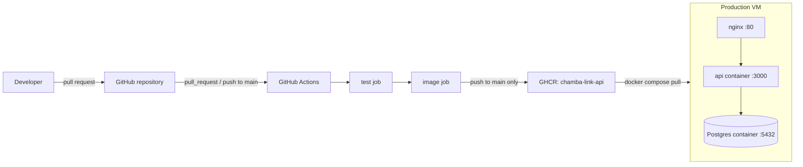

# Architecture

This document describes the components that exist and are deployed today.

## Components

| Component | Source | Notes |
| --- | --- | --- |
| API | `api/src/`, `Dockerfile` | Fastify on Node 24. Serves `GET /healthz`. |
| Migrator | `api/src/migrate.ts` | Ships in the API image as `dist/migrate.js`. |
| Database | `compose.yaml` | `postgres:16` with the named volume `pgdata`. |
| Reverse proxy | `deploy/nginx/chambalink.conf` | nginx installed on the host, not in a container. |
| CI pipeline | `.github/workflows/ci.yml` | Jobs `test` and `image`. See [CI/CD](ci-cd.md). |
| Registry | `ghcr.io/henriquezsergio728-tech/chamba-link-api` | Public, `linux/arm64` only. |

The production VM is a single arm64 host. Production runs `compose.yaml` and `compose.prod.yaml` together. See [Deployment](deployment.md).

## Request path

1. A client sends an HTTP request to port 80 of the production VM.
2. nginx (`server_name _`, `default_server`) proxies it to `http://127.0.0.1:3000` with the `Host`, `X-Real-IP`, `X-Forwarded-For` and `X-Forwarded-Proto` headers set.
3. Docker forwards `127.0.0.1:3000` to port 3000 of the `api` container, where Fastify listens on `0.0.0.0`.

The running API does not open a database connection. Only the migrator connects to Postgres, through `DATABASE_URL`, on the Compose network host `db`.

Production serves plain HTTP on port 80. No TLS is configured.

## Network exposure

| Port | Bound to | Process |
| --- | --- | --- |
| 80 | all interfaces (IPv4 and IPv6) | nginx on the host |
| 3000 | `127.0.0.1` | `api` container (`compose.prod.yaml`) |
| 5432 | `127.0.0.1` | `db` container (`compose.yaml`) |

Docker-published ports bypass the host's iptables `INPUT` rules, so both containers publish on loopback only.

## Health checks

| Service | Check | Defined in |
| --- | --- | --- |
| `api` | `fetch('http://127.0.0.1:3000/healthz')` inside the container, every 10 s | `Dockerfile` |
| `db` | `pg_isready -U $POSTGRES_USER -d $POSTGRES_DB`, every 5 s | `compose.yaml` |

The `api` health check does not check database connectivity. In production, `api` starts only after `db` reports healthy (`depends_on` with `condition: service_healthy`).

## Runtime configuration

| Variable | Read by | Default | Source |
| --- | --- | --- | --- |
| `PORT` | `api/src/server.ts` | `3000` | Image sets `3000` |
| `HOST` | `api/src/server.ts` | `127.0.0.1` | Image sets `0.0.0.0` |
| `NODE_ENV` | `api/src/app.ts` (logging is off when `test`) | unset | Image sets `production` |
| `DATABASE_URL` | `api/src/migrate.ts`, `api/drizzle.config.ts`, booking tests | none | `.env` locally; built from `POSTGRES_*` in `compose.prod.yaml` |
| `POSTGRES_USER`, `POSTGRES_PASSWORD`, `POSTGRES_DB` | `postgres:16` image, Compose interpolation | none | `.env` |
| `API_TAG` | `compose.prod.yaml` image tag | required | Production `.env` |
| `COMPOSE_FILE` | Docker Compose | `compose.yaml` | Production `.env` |

`compose.prod.yaml` places `POSTGRES_PASSWORD` inside a URL, so the password must contain only URL-safe characters.
