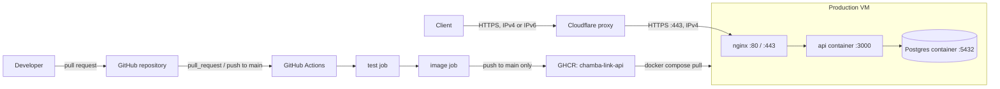

# Architecture

This document describes the components that exist and are deployed today.

## Components

| Component | Source | Notes |
| --- | --- | --- |
| API | `api/src/`, `Dockerfile` | Fastify on Node 24. Serves `GET /healthz`. |
| Migrator | `api/src/migrate.ts` | Ships in the API image as `dist/migrate.js`. |
| Database | `compose.yaml` | `postgres:16` with the named volume `pgdata`. |
| Edge proxy | Cloudflare (Free plan) | DNS for `chambalink.online`; proxies the apex and `www`. Configured in the Cloudflare dashboard, not in the repo. |
| Reverse proxy | `deploy/nginx/chambalink.conf`, `deploy/nginx/cloudflare-real-ip.conf` | nginx installed on the host, not in a container. Terminates TLS. |
| CI pipeline | `.github/workflows/ci.yml` | Jobs `test` and `image`. See [CI/CD](ci-cd.md). |
| Registry | `ghcr.io/henriquezsergio728-tech/chamba-link-api` | Public, `linux/arm64` only. |

The production VM is a single arm64 host. The domain `chambalink.online` is registered at GoDaddy, with DNS hosted on Cloudflare. Production runs `compose.yaml` and `compose.prod.yaml` together. See [Deployment](deployment.md).

## Request path

1. A client resolves `chambalink.online` or `www.chambalink.online` to Cloudflare addresses. `www` is a CNAME to the apex, and both records are proxied.
2. Cloudflare terminates the client's TLS connection. With Always Use HTTPS on, Cloudflare answers plain HTTP requests with a `301` redirect to HTTPS.
3. Cloudflare connects to the production VM on port 443 over IPv4 and validates the origin certificate (SSL/TLS mode Full (strict)).
4. nginx terminates TLS with a Cloudflare Origin CA certificate. For peers in Cloudflare's published ranges it replaces `$remote_addr` with the `CF-Connecting-IP` header (`deploy/nginx/cloudflare-real-ip.conf`).
5. nginx proxies the request to `http://127.0.0.1:3000` with the `Host`, `X-Real-IP`, `X-Forwarded-For` and `X-Forwarded-Proto` headers set.
6. Docker forwards `127.0.0.1:3000` to port 3000 of the `api` container, where Fastify listens on `0.0.0.0`. Fastify takes `request.ip` from `X-Forwarded-For` because its peer is in a loopback or private range (`trustProxy: "loopback,uniquelocal"`).

The running API does not open a database connection. Only the migrator connects to Postgres, through `DATABASE_URL`, on the Compose network host `db`.

The production VM has no IPv6 address. Cloudflare serves clients over IPv4 and IPv6 and reaches the origin over IPv4.

## nginx

`deploy/nginx/chambalink.conf` holds one server block:

- `listen 80 default_server` and `listen 443 ssl http2`, each for IPv4 and IPv6.
- `server_name chambalink.online www.chambalink.online`. `www` is not redirected to the apex.
- `ssl_certificate /etc/ssl/chambalink/origin.pem`, `ssl_certificate_key /etc/ssl/chambalink/origin.key`, `ssl_protocols TLSv1.2 TLSv1.3`.
- One `location /` that proxies to `http://127.0.0.1:3000`.

Port 80 is the `default_server`, so it answers plain HTTP for any `Host`. The host firewall blocks port 80 from outside the VM, so it is reachable on loopback only. Port 443 has no other server block, so nginx uses this one for every TLS connection on it.

The file starts with `include /opt/chambalink/deploy/nginx/cloudflare-real-ip.conf;`, an absolute path into the clone. That file lists Cloudflare's IPv4 and IPv6 ranges as `set_real_ip_from` entries and sets `real_ip_header CF-Connecting-IP`. See [Deployment](deployment.md#cloudflare-real-ip-ranges) for how it is regenerated.

## Trust boundaries

| Boundary | What is trusted | Mechanism |
| --- | --- | --- |
| Client to Cloudflare | Cloudflare's edge certificate | Managed by Cloudflare |
| Network to origin | TCP 443 only from Cloudflare's IPv4 ranges; port 80 not reachable from outside | Host iptables `INPUT` rules on the VM, not in the repo. See [Deployment](deployment.md#firewall). |
| Cloudflare to nginx | The origin presents a certificate signed by Cloudflare Origin CA | SSL/TLS mode Full (strict) |
| nginx visitor address | `CF-Connecting-IP`, only when the peer is in Cloudflare's ranges | `ngx_http_realip_module` with `cloudflare-real-ip.conf` |
| Fastify client address | `X-Forwarded-For`, only when the peer is loopback or private | `trustProxy: "loopback,uniquelocal"` in `api/src/app.ts` |
| Host to containers | Ports `3000` and `5432` bound to `127.0.0.1` | `compose.prod.yaml`, `compose.yaml` |

The host firewall accepts new TCP connections on 443 only from the 15 Cloudflare IPv4 ranges copied on 2026-10-22, and rejects them on 80 from outside the VM. It accepts port 22 from any address. A connection to 443 on the VM itself receives a certificate that only Cloudflare trusts.

## Network exposure

| Port | Bound to | Process |
| --- | --- | --- |
| 22 | not defined in the repo | SSH; the host firewall accepts it from any address |
| 80 | all interfaces (IPv4 and IPv6); reachable on loopback only | nginx on the host, plain HTTP |
| 443 | all interfaces (IPv4 and IPv6); reachable from outside only from Cloudflare's IPv4 ranges | nginx on the host, TLS |
| 3000 | `127.0.0.1` | `api` container (`compose.prod.yaml`) |
| 5432 | `127.0.0.1` | `db` container (`compose.yaml`) |

Docker-published ports bypass the host's iptables `INPUT` rules, so both containers publish on loopback only.

## Health checks

| Service | Check | Defined in |
| --- | --- | --- |
| `api` | `fetch('http://127.0.0.1:3000/healthz')` inside the container, every 10 s | `Dockerfile` |
| `db` | `pg_isready -U $POSTGRES_USER -d $POSTGRES_DB`, every 5 s | `compose.yaml` |

The `api` health check does not check database connectivity. In production, `api` starts only after `db` reports healthy (`depends_on` with `condition: service_healthy`).

## Runtime configuration

| Variable | Read by | Default | Source |
| --- | --- | --- | --- |
| `PORT` | `api/src/server.ts` | `3000` | Image sets `3000` |
| `HOST` | `api/src/server.ts` | `127.0.0.1` | Image sets `0.0.0.0` |
| `NODE_ENV` | `api/src/app.ts` (logging is off when `test`) | unset | Image sets `production` |
| `DATABASE_URL` | `api/src/migrate.ts`, `api/drizzle.config.ts`, booking tests | none | `.env` locally; built from `POSTGRES_*` in `compose.prod.yaml` |
| `POSTGRES_USER`, `POSTGRES_PASSWORD`, `POSTGRES_DB` | `postgres:16` image, Compose interpolation | none | `.env` |
| `API_TAG` | `compose.prod.yaml` image tag | required | Production `.env` |
| `COMPOSE_FILE` | Docker Compose | `compose.yaml` | Production `.env` |

`compose.prod.yaml` places `POSTGRES_PASSWORD` inside a URL, so the password must contain only URL-safe characters.
