# Architecture

This document describes the components that exist and are deployed today.

## Components

```mermaid
flowchart LR
    dev[Developer] -->|pull request| gh[GitHub repository]
    gh -->|pull_request / push to main| actions[GitHub Actions]
    actions --> test[test job]
    test --> image[image job]
    image -->|push to main only| ghcr[GHCR: chamba-link-api]
    ghcr -->|docker compose pull| apphost
    client[Client] -->|HTTPS, IPv4 or IPv6| cf[Cloudflare proxy]
    cf -->|HTTPS :443, IPv4| nginx
    subgraph apphost[Application host, arm64]
        nginx[nginx :80 / :443] --> api[api container :3000]
    end
    subgraph dbhost[Database host, x86_64]
        db[(Postgres container :5432)]
    end
    api -->|TCP 5432, private network| db
    db -->|ops/backup.sh every 6 h| bucket[(Object Storage bucket)]
```

| Component | Source | Notes |
| --- | --- | --- |
| API | `api/src/`, `Dockerfile` | Fastify on Node 24. Serves `GET /healthz`, `GET /v1/openapi.json` and the account and session routes. See [API conventions](#api-conventions) and [Accounts and sessions](#accounts-and-sessions). |
| Migrator | `api/src/migrate.ts` | Ships in the API image as `dist/migrate.js`. |
| Database | `deploy/db/compose.yaml` in production, `compose.yaml` locally | `postgres:16` pinned to a digest, with the named volume `pgdata`. In production, started with `max_connections=50`, `shared_buffers=128MB` and `effective_cache_size=384MB`. |
| Edge proxy | Cloudflare (Free plan) | DNS for `chambalink.online`; proxies the apex and `www`. Configured in the Cloudflare dashboard, not in the repo. |
| Reverse proxy | `deploy/nginx/chambalink.conf`, `deploy/nginx/cloudflare-real-ip.conf` | nginx installed on the host, not in a container. Terminates TLS. |
| CI pipeline | `.github/workflows/ci.yml` | Jobs `test` and `image`. See [CI/CD](ci-cd.md). |
| Registry | `ghcr.io/henriquezsergio728-tech/chamba-link-api` | Public, `linux/arm64` only. |

Production is two hosts. The application host, an arm64 VM.Standard.A1.Flex, runs nginx on the host and only the `api` container, from `compose.prod.yaml` with `deploy/app/compose.yaml`, with `DATABASE_URL` pointing at the database host. The database host, an x86_64 VM.Standard.E2.1.Micro, runs `deploy/db/compose.yaml`, which runs only Postgres and publishes 5432 on the host's private address (`DB_BIND_ADDR`). The domain `chambalink.online` is registered at GoDaddy, with DNS hosted on Cloudflare. See [Deployment](deployment.md#hosts) and [ADR 0012](decisions/0012-dedicated-database-host.md).

`compose.yaml` with `compose.prod.yaml` also runs `db` and `api` together on one host, where the API reaches Postgres at `db:5432`. Production does not use that combination.

## Request path

1. A client resolves `chambalink.online` or `www.chambalink.online` to Cloudflare addresses. `www` is a CNAME to the apex, and both records are proxied.
2. Cloudflare terminates the client's TLS connection. With Always Use HTTPS on, Cloudflare answers plain HTTP requests with a `301` redirect to HTTPS.
3. Cloudflare connects to the application host on port 443 over IPv4 and validates the origin certificate (SSL/TLS mode Full (strict)).
4. nginx terminates TLS with a Cloudflare Origin CA certificate. For peers in Cloudflare's published ranges it replaces `$remote_addr` with the `CF-Connecting-IP` header (`deploy/nginx/cloudflare-real-ip.conf`).
5. nginx proxies the request to `http://127.0.0.1:3000` with the `Host`, `X-Real-IP`, `X-Forwarded-For` and `X-Forwarded-Proto` headers set.
6. Docker forwards `127.0.0.1:3000` to port 3000 of the `api` container, where Fastify listens on `0.0.0.0`. Fastify takes `request.ip` from `X-Forwarded-For` because its peer is in a loopback or private range (`trustProxy: "loopback,uniquelocal"`).
7. For the account and session routes, the API queries Postgres over the private network at the database host's private address, port 5432, as set in `DATABASE_URL`. The connection is not encrypted with TLS.

The API and the migrator reach Postgres through `DATABASE_URL`. The API creates a `pg` connection pool at startup that opens connections only when a query runs. The account and session routes query Postgres; `GET /healthz` and `GET /v1/openapi.json` do not.

The application host has no IPv6 address. Cloudflare serves clients over IPv4 and IPv6 and reaches the origin over IPv4.

## nginx

`deploy/nginx/chambalink.conf` holds one server block:

- `listen 80 default_server` and `listen 443 ssl http2`, each for IPv4 and IPv6.
- `server_name chambalink.online www.chambalink.online`. `www` is not redirected to the apex.
- `ssl_certificate /etc/ssl/chambalink/origin.pem`, `ssl_certificate_key /etc/ssl/chambalink/origin.key`, `ssl_protocols TLSv1.2 TLSv1.3`.
- One `location /` that proxies to `http://127.0.0.1:3000`.

Port 80 is the `default_server`, so it answers plain HTTP for any `Host`. The host firewall blocks port 80 from outside the application host, so it is reachable on loopback only. Port 443 has no other server block, so nginx uses this one for every TLS connection on it.

The file starts with `include /opt/chambalink/deploy/nginx/cloudflare-real-ip.conf;`, an absolute path into the clone. That file lists Cloudflare's IPv4 and IPv6 ranges as `set_real_ip_from` entries and sets `real_ip_header CF-Connecting-IP`. See [Deployment](deployment.md#cloudflare-real-ip-ranges) for how it is regenerated.

## Trust boundaries

| Boundary | What is trusted | Mechanism |
| --- | --- | --- |
| Client to Cloudflare | Cloudflare's edge certificate | Managed by Cloudflare |
| Network to origin | TCP 443 only from Cloudflare's IPv4 ranges; port 80 not reachable from outside | Host iptables `INPUT` rules on the application host, not in the repo. See [Deployment](deployment.md#firewall). |
| Cloudflare to nginx | The origin presents a certificate signed by Cloudflare Origin CA | SSL/TLS mode Full (strict) |
| nginx visitor address | `CF-Connecting-IP`, only when the peer is in Cloudflare's ranges | `ngx_http_realip_module` with `cloudflare-real-ip.conf` |
| Fastify client address | `X-Forwarded-For`, only when the peer is loopback or private | `trustProxy: "loopback,uniquelocal"` in `api/src/app.ts` |
| Host to containers | Port `3000` bound to `127.0.0.1` on the application host | `compose.prod.yaml` |
| Application host to Postgres | TCP 5432 only from the `app-nodes` network security group, on the database host's private address, with the Postgres password; not TLS-encrypted | `DB_BIND_ADDR` in `deploy/db/compose.yaml`; network security groups in OCI, not in the repo. See [Deployment](deployment.md#private-network-access). |

The host firewall on the application host accepts new TCP connections on 443 only from the 15 Cloudflare IPv4 ranges copied on 2026-10-22, and rejects them on 80 from outside the application host. It accepts port 22 from any address. A connection to 443 on the application host itself receives a certificate that only Cloudflare trusts.

## Network exposure

| Host | Port | Bound to | Process |
| --- | --- | --- | --- |
| Application | 22 | not defined in the repo | SSH; the host firewall accepts it from any address |
| Application | 80 | all interfaces (IPv4 and IPv6); reachable on loopback only | nginx on the host, plain HTTP |
| Application | 443 | all interfaces (IPv4 and IPv6); reachable from outside only from Cloudflare's IPv4 ranges | nginx on the host, TLS |
| Application | 3000 | `127.0.0.1` | `api` container (`compose.prod.yaml`) |
| Database | 5432 | the host's private address (`DB_BIND_ADDR`); reachable only from the `app-nodes` network security group | `db` container (`deploy/db/compose.yaml`) |

Docker-published ports bypass the host's iptables `INPUT` rules. The `api` container therefore publishes on loopback only, and 5432 is gated by the bind address, the network security groups and the Postgres password. The subnet's security list has no rule for 5432.

## Backups

A systemd timer on the database host runs `ops/backup.sh` as root every six hours; the application host has no backup timer. The script dumps the database with `pg_dump -Fc` through `docker compose exec -T db`, checks the archive with `pg_restore --list`, and uploads it with the OCI CLI, authenticated as the database host's instance principal, to a private, versioned Object Storage bucket, then compares the stored object's size with the dump's. Restores are manual; see [Restoring from a backup](deployment.md#restoring-from-a-backup). See [Deployment](deployment.md#backups) and [ADR 0011](decisions/0011-database-backups.md).

## Health checks

| Service | Check | Defined in |
| --- | --- | --- |
| `api` | `fetch('http://127.0.0.1:3000/healthz')` inside the container, every 10 s | `Dockerfile` |
| `db` | `pg_isready -U $POSTGRES_USER -d $POSTGRES_DB`, every 5 s | `compose.yaml`, `deploy/db/compose.yaml` |

The `api` health check does not check database connectivity. In production, `api` and `db` run on different hosts, and `deploy/app/compose.yaml` removes the `depends_on` on `db`, so `api` starts without waiting for the database.

## API conventions

Recorded in [ADR 0008](decisions/0008-api-conventions.md):

- Error responses are RFC 9457 `application/problem+json`. Errors other than `AppError` 4xx, validation errors and Fastify's own 4xx errors return a generic `500`; the error is logged with the request id, not returned. Database errors are logged without the query or its parameters.
- Every response carries `x-request-id`: the incoming value if it matches `^[A-Za-z0-9._-]{8,64}$`, otherwise a generated UUID.
- `@fastify/helmet` sets security headers without `Strict-Transport-Security` and `Content-Security-Policy`.
- `GET /v1/openapi.json` returns the OpenAPI document generated from route schemas. Application routes use the `/v1` prefix; `/healthz` stays at the root.
- On `SIGTERM` or `SIGINT` the server closes the app and the Postgres pool and exits `0`, or exits `1` if closing takes more than 8 s.

## Accounts and sessions

Recorded in [ADR 0009](decisions/0009-accounts-and-sessions.md). The routes are in `api/src/auth/routes.ts` and appear in the OpenAPI document:

| Route | Session required | Success |
| --- | --- | --- |
| `POST /v1/auth/register` | No | `201 {account}`, sets the `session` cookie |
| `POST /v1/auth/login` | No | `200 {account}`, sets the `session` cookie |
| `POST /v1/auth/logout` | No | `204`, clears the cookie |
| `GET /v1/me` | Yes | `200 {account}` |

`account` is `{id, role, displayName, email}`. Every response from these routes, including errors, carries `Cache-Control: no-store`.

- `api/src/auth/session.ts` registers `@fastify/cookie`, decorates `request.account` (`null` by default), and exports the `requireAccount` preHandler. It hashes the cookie value with SHA-256, looks the hash up in `sessions` with `expires_at` in the future, and sets `request.account`, or answers `401` with code `UNAUTHENTICATED`. The OpenAPI document declares the cookie as the `apiKey` security scheme `cookieAuth`, used by `GET /v1/me`.
- `api/src/auth/password.ts` hashes passwords with argon2id from `node:crypto`.
- `api/src/audit.ts` appends rows to `audit_log`. See [Data model](data-model.md#audit_log).

| Error | Status | `code` |
| --- | --- | --- |
| Wrong password or unknown email at login | `401` | `INVALID_CREDENTIALS` |
| Missing, unknown or expired session | `401` | `UNAUTHENTICATED` |
| Email already registered, in any letter case | `409` | `EMAIL_TAKEN` |
| Body fails the schema | `400` | none; `errors` lists each problem |
| Rate limit reached on register or login | `429` | `RATE_LIMITED`; `retryAfterSeconds` and the `Retry-After` header give the seconds until the window ends |

The `session` cookie is `HttpOnly`, `SameSite=Lax`, `Path=/`, `Max-Age=2592000` (30 days), and `Secure` when `NODE_ENV` is `production`.

### Rate limiting

Recorded in [ADR 0010](decisions/0010-rate-limiting.md). `api/src/rate-limit.ts` keeps fixed-window counters in the Postgres table `rate_limits` ([Data model](data-model.md#rate_limits)), with windows computed from the application clock.

| Rule | Applies to | Limit |
| --- | --- | --- |
| `REGISTER_IP` | `POST /v1/auth/register`, per client address | 10 per hour |
| `LOGIN_IP` | `POST /v1/auth/login`, per client address | 30 per 15 minutes |
| `LOGIN_EMAIL` | Failed `POST /v1/auth/login` attempts, per lowercased email | 10 per 15 minutes |

- The client address is `request.ip`; an IPv6 address counts by its /64, and an IPv4-mapped IPv6 address as IPv4.
- Requests rejected by schema validation are not counted.
- Login checks the email's failure count before any password work, counts a failure after a wrong password or unknown email, and resets the count after a successful login.
- If a limiter query fails, the error is logged as `rate limiter failed` without query parameters and the request proceeds as if allowed.
- One in a hundred requests to these routes also deletes rate-limit rows older than 24 hours, without waiting for the result.
- `auth.rate_limited` is written to `audit_log` once per key and window.

## Runtime configuration

`api/src/server.ts` and `api/src/migrate.ts` validate their variables with the schemas in `api/src/config.ts` at startup. An empty value counts as unset. If a variable is missing or invalid, they print its name and `missing` or `invalid` to stderr, without the value, and exit with code 1.

| Variable | Read by | Default | Source |
| --- | --- | --- | --- |
| `PORT` | `api/src/server.ts` | `3000`; must be an integer from 1 to 65535 | Image sets `3000` |
| `HOST` | `api/src/server.ts` | `127.0.0.1` | Image sets `0.0.0.0` |
| `LOG_LEVEL` | `api/src/server.ts` | Fastify's default, `info` | Unset in the image and Compose files; one of `fatal`, `error`, `warn`, `info`, `debug`, `trace`, `silent` |
| `NODE_ENV` | `api/src/app.ts` (logging is off when `test`), `api/src/auth/session.ts` (the session cookie is `Secure` when `production`) | unset | Image sets `production` |
| `DATABASE_URL` | `api/src/server.ts` and `api/src/migrate.ts` (required, must start with `postgres://` or `postgresql://`), `api/drizzle.config.ts`, booking, database plugin and auth tests | none | `.env` locally; in `compose.prod.yaml`, the `DATABASE_URL` variable when set, otherwise built from `POSTGRES_*`. Set in the application host's `.env` to the database host's private address |
| `POSTGRES_USER`, `POSTGRES_PASSWORD`, `POSTGRES_DB` | `postgres:16` image, Compose interpolation | none | `.env` locally and on the database host |
| `API_TAG` | `compose.prod.yaml` image tag | required | Application host `.env` |
| `COMPOSE_FILE` | Docker Compose | `compose.yaml` | `compose.prod.yaml:deploy/app/compose.yaml` in the application host's `.env`; `deploy/db/compose.yaml` in the database host's `.env` |
| `DB_BIND_ADDR` | `deploy/db/compose.yaml` port binding | required by that file | Database host `.env`: the host's private address |

`compose.prod.yaml` places `POSTGRES_PASSWORD` inside a URL, so the password must contain only URL-safe characters.
